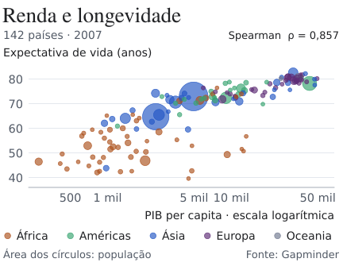
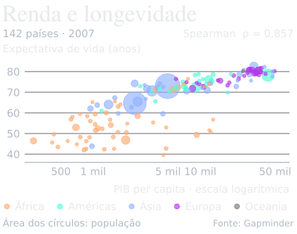

::: {.course-home}

::: {.course-hero}

::: {.course-hero-copy}

```{=html}
<header id="title-block-header" class="quarto-title-block">
<h1 class="title" id="estatística-descritiva-e-inferencial-em-python-para-humanidades">Estatística Descritiva e Inferencial em Python para Humanidades</h1>
</header>
```

[Programação, análise de dados e estatística em Python para estudantes e pesquisadores das humanidades. Os exemplos incluem textos, metadados bibliográficos e indicadores socioeconômicos.]{.course-lead}

::: {.course-actions}
[Começar pelo Encontro 1](encontro_1/enc_1.ipynb){.course-primary}

[Sobre o curso](about.qmd)
:::

::: {.course-byline}
[Jhonatan Lopes](about.qmd#instrutor) · Faculdade de Letras, UFMG
:::

:::

```{=html}
<figure class="course-hero-figure gapminder-figure">


<figcaption><a href="encontro_8/enc_8-parte2.ipynb#visualizacao-editorial">Ver a análise no Encontro 8, parte 2</a></figcaption>
</figure>
```

:::

::: {.course-section-intro}
## Percurso do curso {#encontros}

As aulas combinam fundamentos de Python e raciocínio estatístico: como calcular uma medida, o que ela representa e quando uma comparação é justificável.
:::

::: {.course-modules}
::: {.course-module}
### Módulo 1 — Python e estatística descritiva

```{=html}
<ul class="course-map" role="list" aria-label="Módulo 1">
  <li class="course-map-row">
    <span class="course-map-number">01</span>
    <div class="course-map-entry">
      <a class="course-map-title" href="encontro_1/enc_1.ipynb">Primeiros passos</a>
      <p>Colab, Markdown, Python e lógica.</p>
    </div>
  </li>
  <li class="course-map-row">
    <span class="course-map-number">02</span>
    <div class="course-map-entry">
      <a class="course-map-title" href="encontro_2/enc_2.ipynb">Fundamentos de Python</a>
      <p>Listas, loops, condicionais e dicionários.</p>
    </div>
  </li>
  <li class="course-map-row">
    <span class="course-map-number">03</span>
    <div class="course-map-entry">
      <a class="course-map-title" href="encontro_3/enc_3.ipynb">Funções e métricas lexicais</a>
      <p>Funções, texto e métricas lexicais.</p>
    </div>
  </li>
  <li class="course-map-row">
    <span class="course-map-number">04</span>
    <div class="course-map-entry">
      <a class="course-map-title" href="encontro_4/enc_4.ipynb">NumPy e pandas</a>
      <p>Arrays, tabelas e operações com dados.</p>
    </div>
  </li>
  <li class="course-map-row course-map-interlude">
    <div class="course-map-entry">
      <span class="course-map-label">Interlúdio — </span><a class="course-map-title" href="encontro_5/datasaurus.ipynb">Datasaurus Dozen</a>
      <p>Resumos numéricos, visualização e estrutura dos dados.</p>
    </div>
  </li>
  <li class="course-map-row">
    <span class="course-map-number">05</span>
    <div class="course-map-entry">
      <a class="course-map-title" href="encontro_5/enc_5.ipynb">Estatística descritiva e visualização</a>
      <p>Distribuições, variabilidade e visualização.</p>
    </div>
  </li>
  <li class="course-map-row">
    <span class="course-map-number">06</span>
    <div class="course-map-entry">
      <a class="course-map-title" href="encontro_6/enc_6.ipynb">Forma, normalidade e dispersão</a>
      <p>Forma das distribuições e medidas de dispersão.</p>
    </div>
  </li>
</ul>
```

:::

::: {.course-module}
### Módulo 2 — Associação, probabilidade e inferência

```{=html}
<ul class="course-map" role="list" aria-label="Módulo 2">
  <li class="course-map-row">
    <span class="course-map-number">07</span>
    <div class="course-map-entry">
      <a class="course-map-title" href="encontro_7/enc_7.ipynb">Relações entre variáveis</a>
      <p>Relações entre variáveis e transformação de escalas.</p>
    </div>
  </li>
  <li class="course-map-row">
    <span class="course-map-number">08</span>
    <div class="course-map-entry">
      <a class="course-map-title" href="encontro_8/enc_8.ipynb">Correlação e associação</a>
      <p>Correlação, associação e sensibilidade.</p>
    </div>
  </li>
  <li class="course-map-row course-map-interlude">
    <div class="course-map-entry">
      <span class="course-map-label">Encontro 8, parte 2 — </span><a class="course-map-title" href="encontro_8/enc_8-parte2.ipynb">Visualização</a>
      <p>Heatmaps, gráficos de dispersão e construção visual.</p>
    </div>
  </li>
  <li class="course-map-row">
    <span class="course-map-number">09</span>
    <div class="course-map-entry">
      <a class="course-map-title" href="encontro_9/enc_9.ipynb">Distribuição normal</a>
      <p>Probabilidade e distribuição normal.</p>
    </div>
  </li>
  <li class="course-map-row">
    <span class="course-map-number">10</span>
    <div class="course-map-entry">
      <a class="course-map-title" href="encontro_10/enc_10.ipynb">Amostragem e incerteza</a>
      <p>Amostragem, erro padrão e bootstrap.</p>
    </div>
  </li>
  <li class="course-map-row course-map-interlude">
    <div class="course-map-entry">
      <span class="course-map-label">Encontro 10, parte 2 — </span><a class="course-map-title" href="encontro_10/enc_10-parte2.ipynb">Bootstrap, erro padrão e intervalos de confiança</a>
      <p>Reamostragem por participantes e palavras com dados de decisão lexical.</p>
    </div>
  </li>
  <li class="course-map-row">
    <span class="course-map-number">11</span>
    <div class="course-map-entry">
      <a class="course-map-title" href="encontro_11/enc_11.ipynb">Testes de hipóteses</a>
      <p>Testes de permutação e comparação de proporções.</p>
    </div>
  </li>
  <li class="course-map-row">
    <span class="course-map-number">12</span>
    <div class="course-map-entry">
      <a class="course-map-title" href="encontro_12/enc_12.ipynb">Análise linguística de um corpus jornalístico</a>
      <p>Dispersão lexical, anotação linguística e componentes principais.</p>
    </div>
  </li>
</ul>
```

:::
:::
:::
